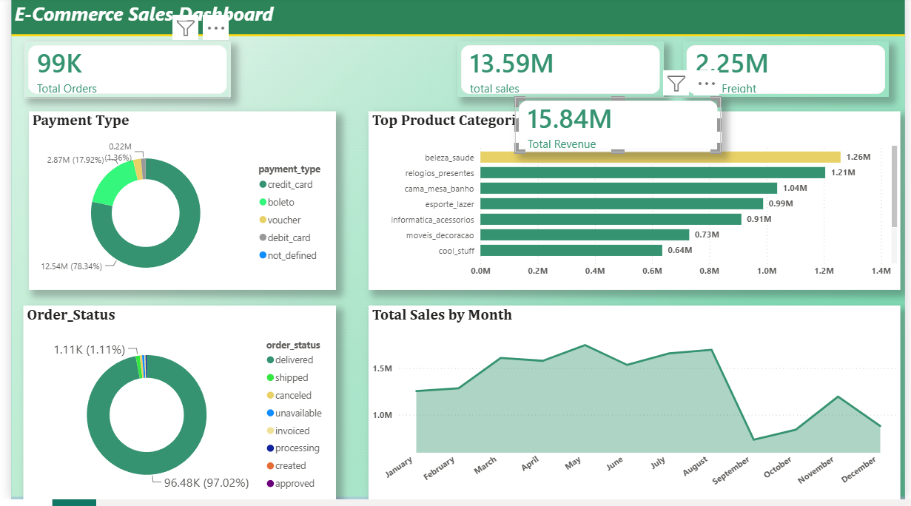

# E-commerce Sales Dashboard | Power BI

**Live Portfolio:** https://muhammad-ali-azam.github.io

### 📊 Overview
Analyzed e-commerce sales data to identify revenue trends, best-selling products, and profit margins. This dashboard helps business owners make data-driven decisions.

### 🛠️ Tools Used
- Power BI Desktop
- DAX & Power Query
- Data Modeling

### 💡 Key Insights
- Total Revenue & Profit Analysis
- Monthly Sales Trend
- Top 10 Products by Sales
- Profit Margin by Category

---
*Developed by Muhammad Ali Azam | Data Analyst from Multan*
